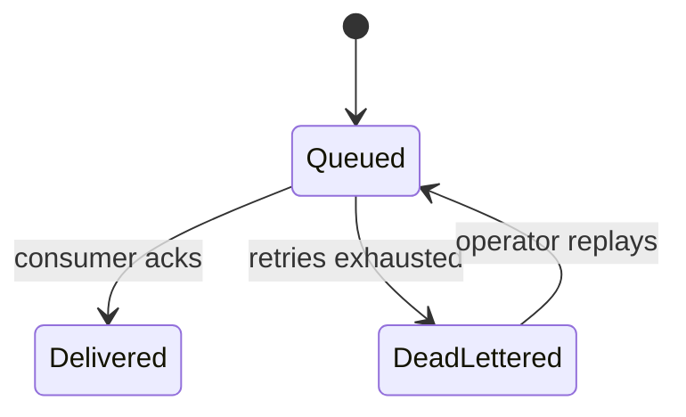

# Create a Product Requirements Document

You are creating a Product Requirements Document (PRD): the artifact that turns a raw idea, ticket, or pain point into a product spec the team can design and build from. It answers WHAT we're building and WHY - the behavior, interfaces, and guarantees that users, operators, and callers rely on. Leave technical implementation to the downstream TDD.

You run the PRD as a guided conversation. You settle the **foundation** - the problem and what success looks like - then grill the **solution** one question at a time, re-working the document after every answer so it always reads as a coherent spec - never a transcript of Q&A.

## How the conversation works

**Exactly one question per message.** End every message with a single question - never a second question, a stacked follow-up, or an "and also...". Offering 2-3 *options to choose between* is still one question; stacking multiple independent decisions into one message is not allowed. Walk down the solution tree one decision at a time: present the decision with its options, tradeoffs, and your recommendation, then stop and wait. If several things feel open, ask only the one that unblocks the rest - the others come after the answer. Never ask for a vague "any feedback?".

**Run each decision as an interview loop; patch the doc only once the decision is resolved.** Ask your one question, then work back and forth until it's settled. The user won't always answer outright - they may push back, think out loud, or ask a clarifying question of their own ("well, how would it work if quality finding = 'passing'?"). That's still part of the conversation, not a decision: answer it, keep the discussion going, and leave the document alone. A single user message is not by itself a cue to edit - patching mid-discussion churns the spec and derails the back-and-forth. Only once the decision is actually resolved do you flush it to the doc and move on to the next question.

**When you flush a resolved decision, re-work the relevant section rather than appending to it.** Fold the decision in: rewrite prose, redraw a diagram, reorder or remove earlier content as needed. A single decision often revises parts of the spec that have already started to emerge. Capture each decision in whatever form conveys it best - a diagram, example, or sketch - reaching for one when the decision calls for it, regardless of whether the question itself used one.

**The doc is always a cohesive description of what's known - never a log.** At any point, the PRD should read like a spec someone wrote on purpose: high-level, coherent, and current - not a list of answers, and not a changelog of decisions. Treat each answer as a reason to re-paint: restructure, reorder, and rebuild the section so it stays a clean, unified description of everything decided so far. **Rewriting entire sections as you go is expected, not exceptional.**

**Show, don't tell.** When behavior is easier to see than to describe - a workflow, a state machine, an exchange between actors, a CLI session, an API call, a config file, or log output - show it with a Mermaid diagram or a concrete example. A quick sketch communicates more than paragraphs of prose. Keep diagrams and examples up to date as decisions evolve.

**Make it read like a document a human designed for other humans.** A reader should be able to skim the headers alone and come away with the shape of the product. Give every section and sub-point a header that states its *takeaway* - the way a good slide title asserts its message ("Retries never deliver a message twice"), not a generic topic label ("Retries"). Keep paragraphs short, and place each diagram or example immediately beside the prose it illustrates - never let the text become a wall with all the visuals piled at the end. Lead with the point, then support it.

**Stay in product space.** Only ask product questions - behavior, interfaces, and guarantees as users and callers see them. If you find yourself reaching for database schemas, storage locations, or implementation architecture, note it in a "Deferred to TDD" section and move on.

**Get more context when you need it.** When a decision depends on how the product or codebase actually works, investigate before presenting options: read the relevant code or docs, search the web, or delegate focused investigations to subagents. Don't ask the user what the project can answer.

## 1. Understand the context

Find the product context the user points to and read every relevant file **fully**.

There is no required upstream artifact. The product context might be a detailed ticket, a research doc, or just a couple of sentences describing what the user wants. Work from whatever is present.

- Ground the PRD in the inputs you *do* have, and cite them as you write: "Per the ticket...", "The research doc notes...".
- Don't duplicate upstream content into the PRD - reference it.
- If the context is thin, don't invent requirements. Surface the gaps as questions during the interview and let the user fill them in.

## 2. Write the skeleton

Write the doc to `.tasks/{task}/prd.md` at the project root. Create the directory lazily. `{task}` names the piece of work: the ticket ID plus a short slug when there's a ticket (`eng-1234-dead-letter-replay`), otherwise just the slug (`dead-letter-replay`). Use lowercase kebab-case.

Use the template in [PRD-FORMAT.md](./PRD-FORMAT.md). **Keep the skeleton as minimal as possible. No preamble, no setup, no summaries.** The faster you reach the first question, the more the user stays engaged in building the PRD. Write only:

- The top-level title
- A **Problem to Solve** section with your first-draft problem statement
- Empty **What does business success look like, and how can we measure it?**, **Proposed Solution**, and **Solution Details** headers - built out through the interview

Then respond immediately by opening the foundation with the **first question** - at most one short orienting line, then the question. Quote the actual "Problem to Solve" content you drafted so the user reacts to the exact wording, not a summary. For example:

> I've started the PRD at `.tasks/eng-1234-dead-letter-replay/prd.md`. First question: does this **Problem to Solve** sound right?
>
> > ...your statement of the problem...
>
> Tell me what's off, or confirm it and we'll move to what success looks like.

When you write markdown that itself contains a code block showing other markdown, use 4 backticks for the outer fence so the inner 3-backtick block doesn't close it early:

````markdown
# Example heading
```bash
npm install example
```
````

## 3. Settle the foundation

Settle the foundation one piece at a time, re-working the document as each is locked in. Wait for the user's response at each step.

**a. Problem to Solve.** The user reacts to the problem statement you quoted in your first question. Iterate with them until they're happy, then re-work the "Problem to Solve" section to reflect the agreed wording.

**b. What success looks like.** Once the problem is settled, move to success. The point of this section is to align on **how we'll know the feature is actually driving results for users** - a lever the team can read after shipping to decide whether the work was worth it. Treat that lever as part of the definition of done. Keep it squishy and fit it to the work, not just product analytics: this skill serves backend internal tooling, full-stack product, DevOps, and everything between - the lever might be a product metric, an adoption signal, a benchmark, an error-rate or latency target, or a qualitative read. Anything worth doing is worth measuring. Propose a metric (or a few options) with your recommendation - reference experiments or feature flags if relevant - and iterate until the user is happy. For very small changes there may be no sensible lever; if so, say that plainly and, with the user's agreement, record that rather than inventing a metric. Then re-work the "What does business success look like, and how can we measure it?" section.

Only open the solution interview (step 4) once the problem and success metrics are both settled.

## 4. Solution interview

Now grill the solution. **Ask exactly one question per message, walking down each branch of the solution tree.** Resolve one decision, let it inform the next, and only then ask the next. Each question is a brush stroke that adds detail to the document - you're progressively painting the Solution Details, not logging Q&A.

For each decision: present a single decision with options and your recommendation (when the options differ in observable behavior, show each one as a concrete example - "Option A vs Option B" side by side) -> work back and forth until the decision is resolved (clarifying questions and pushback are part of this, not a cue to patch) -> only then re-work the **Solution Details** so it absorbs the decision, keeping it one coherent spec. Reach for a diagram or example whenever it captures the decision best.

When an answer reshapes the work, touch every affected section in the same pass: refine **Proposed Solution** if the high-level approach changed, move ruled-out paths into **Out of Scope**, and keep diagrams and examples in sync with the prose.

**Stay in product space.** Only ask product questions. If a question is really about schemas, storage, or implementation architecture, note it under a "Deferred to TDD" section and move on.

### Solution representations

Pick the form that makes each decision clearest. Keep them at the level of what users and callers observe, not how it's built.

**Mermaid diagrams** for workflows, state machines, and exchanges between actors:



**Concrete examples** of the interface as a user or caller meets it - a CLI session, an API call, a config file, or log output:

```text
$ queuectl replay --queue billing --since 1h
replayed 42 messages from billing.dlq
```

When a concept is too complex for Mermaid or plain text, write one focused HTML file next to the PRD, named `diagram-{description}.html`. Keep it focused on the decision at hand and use realistic labels, not lorem ipsum. Tell the user its path.

## 5. Solution review gate

When the solution is fully fleshed out, stop and hand it back for review. Because you've been building it decision by decision, the user hasn't read it as a whole yet. Say something like:

> I think the solution is complete. Since we've built it up decision by decision, can you read the **Solution Details** top to bottom and confirm it hangs together before we wrap up?

Wait for the user's approval and incorporate any fixes they raise.

## 6. Wrap up

When the solution is approved, give the user the path to the PRD, a short summary of the product spec, and any open questions. Suggest the TDD as the next step, using the `create-tdd` skill. Do not implement.
